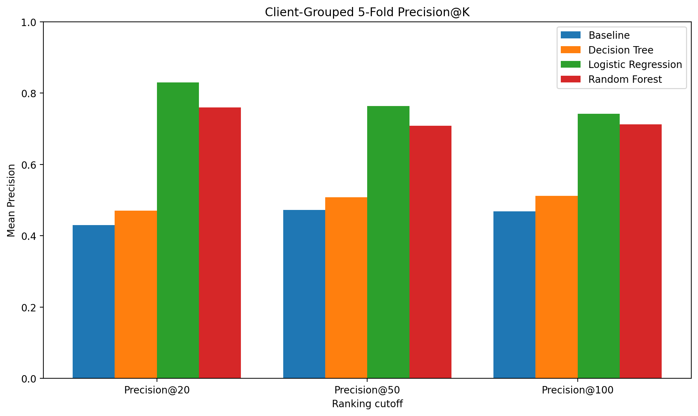
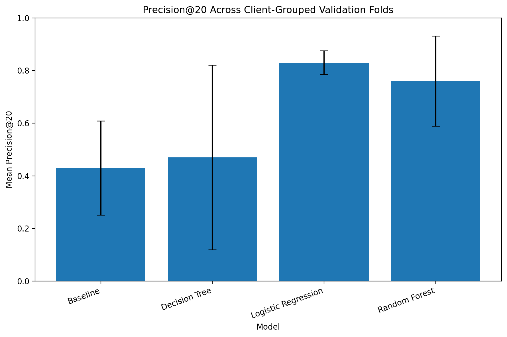

# Machine Learning for Content Refresh Prioritization

A Client-Grouped Evaluation of SEO Content Opportunity Scoring

**Teninlanimi Olajide**  
Machine Learning Intern, FlyRank  
August 25, 2026

**Project repository:** [FlyRank ML Internship repository](https://github.com/flyrank-bih/flyrank-ml-internship-starter)  
**Organization:** [FlyRank](https://flyrank.ai/)


# Abstract

This study investigates whether machine learning can improve the prioritization of existing web content for potential refresh by identifying observations associated with declining performance. Using a pseudonymized FlyRank SEO and web analytics dataset containing 30,000 content-level observations, the analysis combined search, content, freshness, engagement, and historical performance signals while excluding target-derived fields and pseudonymous identifiers from the predictive features. A rule-based baseline was compared with Logistic Regression, Decision Tree, and Random Forest models, with performance evaluated primarily using Precision@K under five-fold client-grouped cross-validation. Logistic Regression achieved the strongest mean Precision@20 of 0.83 across held-out client groups, compared with 0.43 for the repository baseline, while also showing relatively low variation across folds. The resulting model provides a ranked decision-support queue that can help content teams prioritize pages for human review rather than automatically deciding which pages should be refreshed.

# Introduction / Problem statement

The objective of this project is to support content-refresh prioritization for SEO teams. Content teams may manage large numbers of web pages but have limited time and resources to review every page. The decision supported by this system is therefore: **which existing content items should be reviewed first for a potential refresh?**

The unit of analysis is the **content item/page**. Each observation represents a content item described by its content characteristics, SEO signals, and historical search-performance signals.

The output of the system is a **priority score and ranked queue**. Higher-scoring observations are placed nearer the top of the queue so that a content team can focus its attention on pages with stronger evidence of potential opportunity.

The model does not automatically decide that a page should be refreshed. Instead, a FlyRank editor or content specialist can review a ranked item alongside its supporting signals and reason codes, then decide whether the page requires further investigation, updating, or no action.

The cost of a wrong prioritization decision can occur in both directions. A false positive may cause a content team to spend limited resources reviewing or refreshing a page that does not require attention. A false negative may cause a potentially valuable refresh opportunity to be overlooked while resources are directed elsewhere. Because review capacity is limited, the quality of the highest-ranked recommendations is particularly important.

Machine learning is useful for this problem because the available data contains multiple signals that may jointly indicate declining or refresh-relevant content. These signals include historical impressions, clicks, search position, CTR, content age, time since the last update, search demand, and content characteristics. Rather than relying only on a manually specified rule, a supervised learning model can learn relationships between these signals and the observed target and use the resulting scores to prioritize observations.

The system is therefore designed as a **decision-support tool rather than an autonomous content-refresh system**. Its purpose is to reduce the search space for human reviewers and help allocate limited editorial attention to pages most likely to warrant investigation.

# Data

The analysis used pseudonymized SEO and web analytics data provided through the FlyRank ML Internship environment. The modelling dataset contained 30,000 content-level observations with SEO, content, and historical performance variables.

The feature set was restricted to information that could be used as input to the prioritization model. The target-derived fields `trend_direction` and `trend_pct` were deliberately excluded from the model features because they directly describe the outcome from which the binary target was constructed. Including either field would allow the model to access information too closely related to the target and could introduce target leakage.

The binary target, `is_declining_label`, was constructed from `trend_direction`. An observation was assigned a value of 1 when its trend direction was `"down"` and 0 otherwise. The target itself was therefore never included as a predictor.

Pseudonymous identifiers were also excluded from the feature matrix. In particular, `client_id` and `content_id` were not used as predictive features. `client_id` was retained only for constructing client-grouped validation folds, allowing observations belonging to the same client to remain together during evaluation. This use of the identifier was for evaluation design rather than prediction.

The analysis also considered the risk of leakage from historical performance variables. Features were intended to represent information available for the prioritization task rather than future outcomes. The preprocessing and model-fitting workflow was applied within the training data for each evaluation fold before being applied to the held-out observations.

The use of pseudonymized data also required care in the presentation of results. No client names, domains, URLs, or other client-identifying information were used as modelling features or intentionally exposed in the research paper.

Before submission, the contents of `work/` should be checked to confirm that no client-identifying information appears in notebooks, exported tables, plots, logs, or other committed artifacts. The final paper reports only aggregate modelling and evaluation results.

# Methodology

## Baseline

A transparent rule-based scoring system was established before evaluating the supervised learning models. The purpose of the baseline was to provide a simple reference for determining whether machine learning added useful ranking signal beyond manually specified SEO and content heuristics.

The repository baseline combined four normalized signals:

[
BaselineScore =
0.40V + 0.30F + 0.25P + 0.05D
]

where (V) represents visibility, (F) represents freshness, (P) represents search position, and (D) represents content depth.

The baseline was designed to reflect the practical intuition behind content-refresh prioritization: pages with meaningful visibility, weaker freshness, less favourable search positions, and relevant content-depth characteristics may warrant greater attention.

The baseline provides a fair comparison because it uses the same observations and produces a ranking that can be evaluated using the same ranking metric as the supervised models. Rather than asking whether machine learning can classify observations more accurately than a rule, the comparison asks whether the learned models can place relevant observations higher in the prioritization queue.

For the client-grouped five-fold evaluation, the baseline achieved a mean Precision@20 of **0.43**, with a standard deviation of approximately **0.179** across the five folds. The positive class represented approximately **54.2%** of the 30,000 observations, providing an important reference point when interpreting the Precision@20 result.

The baseline therefore provided a transparent and reproducible benchmark against which the machine learning approaches could be assessed. Any model-based improvement should be interpreted relative to this benchmark rather than against an assumption that a more complex model is automatically better.

## Model / analysis

The modelling task was formulated as a binary classification problem with a ranking-oriented output. The objective was to estimate the likelihood that a content observation belonged to the positive class and then use the resulting model scores to rank observations for content-refresh review.

Three supervised learning approaches were evaluated: Logistic Regression, Decision Tree, and Random Forest. These models were selected to provide a comparison between a relatively simple linear model, an interpretable non-linear model, and a more flexible ensemble method. The rule-based baseline described above was retained as the reference point.

The target variable was `is_declining_label`, defined as 1 when `trend_direction` was `"down"` and 0 otherwise.

### Model features

The final modelling feature set contained 26 predictors: 18 numerical features and 8 categorical features.

#### Numerical features

The numerical feature set was:

* `search_volume`
* `competition`
* `cpc`
* `word_count`
* `char_count`
* `log_impressions_90d`
* `log_clicks_90d`
* `log_sessions_90d`
* `log_ai_sessions_90d`
* `days_with_impressions`
* `days_with_sessions`
* `content_age_days`
* `days_since_last_update`
* `ctr`
* `avg_position`
* `engagement_rate`
* `scroll_rate`
* `ai_traffic_pct`

Log-transformed versions of selected performance variables were used to represent highly skewed traffic and engagement measures while reducing the influence of extreme values.

#### Categorical features

The categorical feature set was:

* `competition_level`
* `content_type`
* `main_intent`
* `age_tier`
* `freshness_tier`
* `word_count_tier`
* `impression_tier`
* `position_tier`

These categorical representations allowed the models to capture threshold-like differences between groups such as freshness, visibility, content length, and search-position tiers.

### Features deliberately excluded

Several variables were deliberately excluded from the predictive feature matrix.

`trend_direction` and `trend_pct` were excluded because they are directly related to the observed trend used to construct the target and could introduce target leakage.

`client_id` was excluded as a predictive feature because it is a pseudonymous identifier rather than a generalizable content characteristic. It was retained only for constructing the client-grouped validation folds.

`content_id` was also excluded because it identifies an individual content item rather than representing a generalizable predictive signal.

The target variable, `is_declining_label`, was excluded from the feature matrix by definition.

### Preprocessing and model output

Numerical and categorical features were processed separately within the modelling pipeline. Numerical variables were transformed using the preprocessing required by the respective model, while categorical variables were encoded into numerical representations.

For Logistic Regression, numerical features were scaled because the model is sensitive to feature scale. The tree-based models did not require scaling for their decision rules.

The fitted models produced scores for the positive class. These scores were used to rank observations from highest to lowest priority rather than relying only on a binary class prediction.

This ranking-oriented output aligns the model with the operational objective: helping a content team determine which pages should be reviewed first.

# Results

## Validation strategy

The final evaluation used five-fold `GroupKFold` cross-validation with `client_id` as the grouping variable.

Grouping by client was used to prevent observations belonging to the same client from appearing in both the training and evaluation portions of a fold. This provides a more demanding test of generalization because each held-out fold contains clients that were not represented in the corresponding training data.

The grouping variable was used only to construct the validation folds and was excluded from the model feature matrix.

For each fold, the preprocessing pipeline and model were fitted using the training clients and then applied to the held-out clients. The resulting model scores were used to rank the held-out observations.

## Evaluation metrics

The primary metric was Precision@K, evaluated at K = 20, 50, and 100.

Precision@K measures the proportion of positive observations among the first K observations in the ranked queue:

[
Precision@K =
\frac{\text{Positive observations in top }K}{K}
]

Precision@20 was treated as the primary operational metric because it represents a small review queue. Precision@50 and Precision@100 were included to determine whether ranking quality remained strong as the number of recommended observations increased.

The positive class represented approximately 54.2% of the 30,000 observations. This base rate is reported alongside Precision@K so that the ranking results are not interpreted without reference to the underlying class distribution.

Conventional classification metrics were treated as supplementary measures because the primary objective was prioritization rather than assigning an independent class label to every observation.

## Client-grouped results

The mean Precision@20 across the five client-grouped folds was:

| Model               | Mean Precision@20 | Standard Deviation |
| ------------------- | ----------------: | -----------------: |
| Repository Baseline |              0.43 |              0.179 |
| Decision Tree       |              0.47 |              0.351 |
| Logistic Regression |          **0.83** |          **0.045** |
| Random Forest       |              0.76 |              0.171 |

The client-grouped results show a clear difference between the rule-based baseline and the learned models. Logistic Regression produced the highest mean Precision@20 at 0.83, followed by Random Forest at 0.76. The Decision Tree achieved 0.47, while the repository baseline achieved 0.43.

### Precision@K across client-grouped folds



*Figure 1. Mean Precision@K across five client-grouped validation folds. Logistic Regression achieved the strongest ranking performance across P@20, P@50, and P@100.*

The advantage of Logistic Regression was not limited to the top 20 observations. It maintained the strongest ranking performance across the evaluated queue sizes, while Random Forest also remained above the baseline. This indicates that the machine-learning approaches were able to concentrate more positive observations toward the top of the ranked queue than the rule-based baseline.

The relatively small standard deviation for Logistic Regression also indicates that its Precision@20 varied less across the five held-out client groups than the other evaluated approaches.

### Precision@20 variability across client groups



*Figure 2. Mean Precision@20 with fold-level variability under client-grouped validation. Logistic Regression achieved the highest mean performance while showing comparatively low variation across client groups.*

The combination of high mean Precision@20 and comparatively low variability is important for the intended use case. A model that performs well on average but varies substantially across client groups may provide inconsistent prioritization quality. Logistic Regression showed a stronger balance between ranking performance and stability under the client-grouped evaluation.

## Error analysis

Because the operational objective is ranking rather than binary decision-making, error analysis focused on the composition of the ranked queue rather than only on false-positive and false-negative counts.

A high-ranked observation can be considered a prioritization error when it is placed near the top of the queue despite belonging to the negative class. Conversely, a relevant observation ranked substantially lower represents a missed prioritization opportunity.

The client-grouped results showed that model performance varied across clients. This variation was most pronounced for the tree-based approaches, particularly Decision Tree, which had a substantially larger standard deviation across folds.

This indicates that model performance was not uniform across all client groups and reinforces the importance of evaluating the system across held-out clients rather than relying on a single aggregate score.

The analysis also indicates that a high Precision@20 should not be interpreted as proof that every highly ranked page requires a refresh. The target represents an observed declining trend, while the final refresh decision remains a human editorial decision.

## Initial evaluation versus final validation

An earlier row-level evaluation produced stronger apparent ranking performance for some models, including a Precision@20 of 0.90 for Logistic Regression.

However, those results were treated as an initial model comparison rather than the final estimate of generalization. The client-grouped evaluation was considered more appropriate because it prevents observations from the same client from being distributed across training and evaluation folds.

The final model selection therefore relies on the client-grouped results rather than comparing results from different validation schemes.

This distinction is important when interpreting the reported performance: the final result represents average ranking behaviour across held-out client groups rather than performance on a randomly selected subset of rows.

# Limitations & honest framing

The evaluation provides evidence that the modelling approach can improve prioritization of observations associated with declining trends relative to the repository baseline. However, several limitations affect how the results should be interpreted.

First, the target represents an observed declining trend rather than the future effect of a content refresh. A positive prediction therefore indicates that an observation resembles the declining class used during training; it does not establish that refreshing the page will improve its future SEO performance.

Second, the evaluation used the available pseudonymized dataset and five client-grouped validation folds. Although this provides a stricter assessment of generalization than a random row-level split, performance may differ for future clients, different content portfolios, or data collected under different search conditions.

Third, model performance varied across client groups. Logistic Regression showed comparatively low variation, but no model produced identical performance across all held-out groups. This indicates that client characteristics may influence the difficulty of the prioritization task.

Fourth, search demand should not be interpreted as a direct measure of page-level opportunity. The exploratory analysis found almost no linear correlation between search volume and page impressions. This suggests that keyword-level demand and actual page-level search exposure represent different aspects of the problem.

Finally, CTR must be interpreted together with search position. CTR was highly skewed, and the relationship between CTR and performance differed across position tiers. A low CTR alone therefore does not establish that a page has poor content quality or requires refreshing.

These limitations mean that the system should be treated as a **decision-support mechanism rather than an autonomous content-refresh system**. The model narrows the set of pages requiring attention, while human review remains responsible for the final decision.

# Ranked recommendations

The recommended use of the model is as a prioritization layer within a human-in-the-loop content-refresh workflow. The model should generate a ranked queue of content items, with the highest-scoring observations presented first for editorial review.

A FlyRank editor could use the output in the following workflow:

1. **Review the ranked queue.** Start with the highest-priority content items rather than manually reviewing the full content portfolio.

2. **Inspect the supporting signals.** Review the page's visibility, search position, freshness, traffic, engagement, and content characteristics alongside the model score.

3. **Review the reason code.** Use the available reason code to understand the primary signal that contributed to the item's prioritization.

4. **Apply editorial judgement.** Determine whether the page represents a genuine refresh opportunity based on the page's topic, search intent, business context, and other information unavailable to the model.

5. **Select the appropriate action.** A page may be recommended for refresh, further investigation, monitoring, or no immediate action.

6. **Monitor outcomes.** Pages selected for action can be monitored after the intervention to determine whether their performance changes over time.

The model should therefore be treated as a system for **prioritizing attention**, not as an automated refresh decision-maker. A high model score indicates that an observation resembles the positive class used during training; it does not establish that refreshing the page will improve its future performance.

## Recommended operating policy

Based on the client-grouped evaluation, Logistic Regression is the recommended model for the initial prioritization workflow. It achieved the strongest mean Precision@20 among the evaluated approaches while also showing relatively low variation across the five client-grouped folds.

The top of the ranked queue should receive the greatest review priority because the primary objective is to concentrate potentially relevant observations where editorial capacity is most limited. However, the queue should remain subject to human review rather than being converted directly into automatic refresh actions.

The existing rule-based baseline can be retained as a transparent reference point and fallback. Monitoring the model against this baseline over time would provide a simple way to detect whether the machine-learning system continues to provide useful ranking improvement.

## Confidence and limitations

Confidence in the recommendation is strongest for the specific task and dataset evaluated in this study. Logistic Regression consistently produced the strongest mean Precision@20 across the client-grouped validation folds, providing evidence that it is a useful prioritization approach within the evaluated setting.

However, the results should not be interpreted as evidence that the model will perform identically for every future client or dataset. Additional validation would be appropriate before production deployment.

The target also represents an observed declining trend rather than the future effect of a content refresh. Consequently, the model does not estimate the causal impact of refreshing a page.

Other limitations include potential changes in search behaviour, content portfolios, client characteristics, and data distributions over time. These changes could reduce model performance after deployment and should be monitored.

The recommended system is therefore a decision-support tool: it helps reduce the number of pages that editors need to investigate first, while the final content-refresh decision remains with a human reviewer.

# Reproducibility

The analysis was developed in Python using Jupyter notebooks and the scikit-learn modelling ecosystem. The project repository contains the notebooks, supporting outputs, and paper source used to reproduce the analysis.

## Reproduction workflow

From a fresh clone of the repository, the analysis can be reproduced by installing the project dependencies, launching the notebook environment, running the modelling workflow, and rendering the Quarto paper.

The main workflow is:

```text
1. Clone the repository
2. Install the required Python dependencies
3. Open the project in VS Code or Jupyter
4. Run the analysis and modelling notebooks in order
5. Confirm the generated evaluation outputs
6. Render the research paper with Quarto
```

The final paper uses the figures stored in `paper/charts/` so that the rendered document does not depend on paths outside the paper directory.

# Acknowledgments & data credit

Built on the FlyRank ML Internship dataset.

The dataset and project were provided as part of the FlyRank ML Internship program. Data used in this analysis was pseudonymized for the internship environment.

No client-identifying information is intentionally exposed in this report. The analysis and recommendations presented here are based on the internship dataset and modelling workflow described above.
